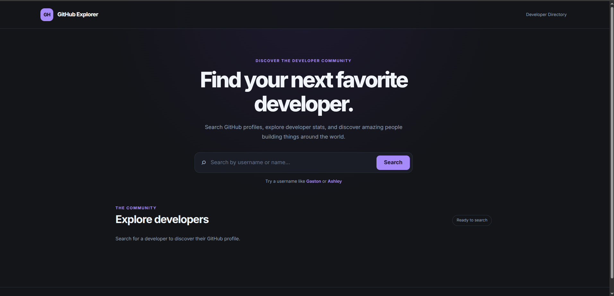
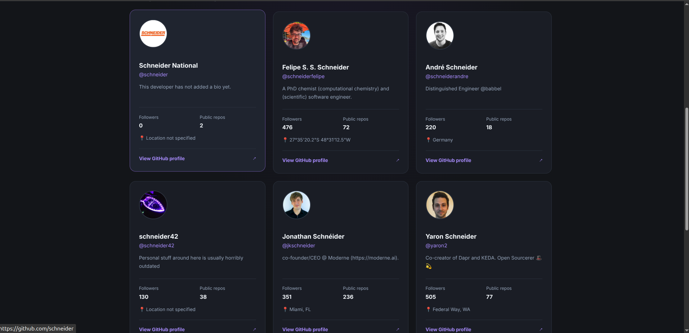

# 🐙 GitHub Profile Viewer

> A responsive web application built with HTML, CSS, and JavaScript that allows users to search for GitHub profiles, explore matching users, and open their GitHub profiles in a new tab through a clean, interactive, and user-friendly interface.

---

## 📌 Problem Statement

Finding and accessing GitHub user profiles by username is a useful way to explore developers and their work. This project demonstrates how a web application can retrieve and display GitHub user information dynamically using JavaScript and the GitHub API.

The project also focuses on creating an intuitive search experience, presenting profile information clearly, and making it easy for users to navigate directly to GitHub profiles.

---

## 🎯 Project Goals

- Build a responsive GitHub profile search application.
- Practice HTML structure and semantic markup.
- Improve CSS styling and responsive layouts.
- Learn how to work with external APIs using JavaScript.
- Practice asynchronous JavaScript with `fetch()` and `async/await`.
- Strengthen DOM manipulation and event-handling skills.
- Display GitHub profile information dynamically.
- Improve user experience through interactive search results.

---

## 🛠 Tech Stack

**Frontend:**

- HTML5
- CSS3
- JavaScript (ES6)

**API:**

- GitHub REST API

**Other Tools:**

- Git & GitHub
- VS Code
- GitHub Actions for automated code linting

---

## 🖥 Features

- Search for GitHub users by username.
- Display matching GitHub profiles.
- View profile information retrieved from the GitHub API.
- Open a selected user's GitHub profile in a new browser tab.
- Handle empty search input.
- Handle users who cannot be found.
- Display search results dynamically using JavaScript.
- Responsive and mobile-friendly design.
- Clean and user-friendly interface.
- Automated code quality checks using GitHub Actions.

---

## 📸 Screenshot




> **Note:** Replace the screenshot path above with the actual location and filename of your project screenshot if they differ.

---

## ⚙ Installation & Setup

### 📥 Clone the repository

```bash
git clone git@github.com:Hache-premier/Github-profile-viewer.git
cd Github-profile-viewer
```

---

### ▶ Run the project

You can open the application in your browser in two ways.

**Option 1: Direct Open**

- Open the `index.html` file in your preferred web browser.

**Option 2: Live Server (Recommended)**

- Install the **Live Server** extension in VS Code.
- Open the project folder in VS Code.
- Right-click `index.html`.
- Select **Open with Live Server**.

---

## 🧠 Challenges Faced

- Connecting the application to the GitHub REST API.
- Fetching GitHub user information asynchronously.
- Handling API responses and search results.
- Managing empty searches and unsuccessful user lookups.
- Updating the interface dynamically using JavaScript.
- Designing a responsive layout for different screen sizes.
- Maintaining consistent code quality through automated linting.
- Configuring GitHub Actions to validate project files.

---

## 📚 What I Learned

- How to work with external APIs using JavaScript.
- How to use `fetch()` to retrieve data from an API.
- How `async/await` works with asynchronous operations.
- How to handle API responses and errors.
- How to manipulate HTML elements using the DOM.
- How to use event listeners to respond to user actions.
- How to display API data dynamically.
- How to create responsive layouts using CSS.
- How to use Git and GitHub for version control and collaboration.
- How to use GitHub Actions to automate code quality checks.
- How to build an interactive web application using HTML, CSS, and JavaScript.

---

## 🚀 Future Improvements

- Display additional GitHub profile information.
- Show the user's public repositories.
- Display follower and following counts.
- Add pagination for search results, where supported.
- Add loading indicators during API requests.
- Improve error messages and empty states.
- Add sorting and filtering options for search results.
- Improve accessibility and keyboard navigation.
- Add a search history feature.
- Improve the visual presentation of profile cards.

---

## 👨🏽‍💻 Author

**Ndonwi Ashley Cheo**  
Software Engineering Student

🌍 Based in Cameroon | Passionate about web development and continuously learning new technologies 🚀
